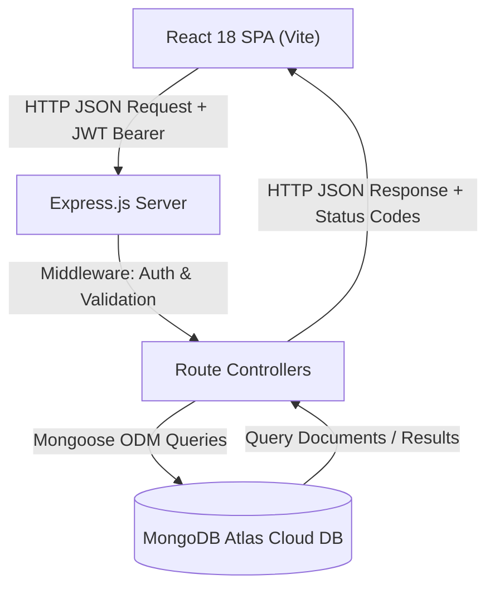

# ICT ACADEMY OF KERALA (ICTAK)
## Summer Internship & Capstone Project Report
### Full Stack Application Development with ReactJS & Node.js (MERN)

---

# CareerConnect: An Intelligent Campus Placement & Internship Management Ecosystem

**Candidate Name:** Fayiz Mohammed (`fayiz225027`)  
**Institution:** Sahrdaya College of Engineering and Technology  
**Curriculum Partner:** Information & Communication Technology Academy of Kerala (ICTAK)  
**Submission Date:** October 25, 2026  
**Document Version:** 1.0 (Final Evaluation Copy)  

---

## TABLE OF CONTENTS
1. [Executive Summary](#1-executive-summary)
2. [Introduction](#2-introduction)
   - 2.1 Background
   - 2.2 Problem Context
   - 2.3 Proposed Solution
3. [Objectives](#3-objectives)
   - 3.1 Primary Technical Objectives
   - 3.2 Pedagogical & Skill Growth Objectives
4. [Scope and Deliverables](#4-scope-and-deliverables)
   - 4.1 Scope of the Project
   - 4.2 Key Project Deliverables
5. [Methodology](#5-methodology)
   - 5.1 Architecture & Separation of Concerns
   - 5.2 Development Lifecycle & Agile Sprints
   - 5.3 Technology Selection Rationale
6. [Project Activities](#6-project-activities)
   - 6.1 Database Modeling & MongoDB Schema Design
   - 6.2 Backend RESTful API & Security Middleware
   - 6.3 Frontend Single Page Application Development
   - 6.4 API Integration, State Management & Interceptors
   - 6.5 Challenges Encountered & Mitigation Strategies
7. [Results & Findings](#7-results--findings)
   - 7.1 System Implementation Verification
   - 7.2 Core Flow Accomplishments
   - 7.3 Performance & Quality Benchmarks
   - 7.4 Visual Artifacts & Screen Walkthrough
8. [Conclusion](#8-conclusion)
   - 8.1 Summary of Learnings
   - 8.2 Future Enhancements
9. [Appendix](#9-appendix)
   - 9.1 Submission Links
   - 9.2 Complete API Endpoint Reference
   - 9.3 Evaluator Credentials

---

## 1. EXECUTIVE SUMMARY

The capstone internship project, **CareerConnect**, is a comprehensive, production-grade MERN Stack web platform developed under the guidance of the **Information & Communication Technology Academy of Kerala (ICTAK)**. The project bridges the transition between academic software engineering training and industry employment by providing a modern, role-based internship and job portal tailored for graduating developers.

The primary objective was to architect and deliver an end-to-end full-stack web application featuring robust authentication with JSON Web Tokens (JWT) and salted bcrypt hashing, granular Role-Based Access Control (RBAC) across three distinct actors (Students, Recruiters, and Academic Administrators), high-performance search and filtering, atomic application lifecycle tracking, and comprehensive recruiter evaluation workflows.

The system was developed strictly following the guidelines specified in the *ICTAK MERN Stack Project Guidelines & Student Reference Guide*. The client-side application was engineered in React 18 utilizing Vite for rapid bundling, React Router v6 for client routing, and Axios with custom interceptors for resilient API communication. The server-side was built with Express.js and Node.js, orchestrating RESTful endpoints and communicating with a cloud MongoDB Atlas database via Mongoose ODM. 

All validation criteria, acceptance tests, and visual regression benchmarks were successfully achieved. The platform is version-controlled on GitHub with an active commit history, hosted for public evaluation, and accompanied by formal Software Requirements Specifications (SRS) and visual evidence.

---

## 2. INTRODUCTION

### 2.1 Background
As the demand for full-stack web engineering talent grows in Kerala’s expanding IT corridors (Technopark, Infopark, Cyberpark), academic institutions require streamlined channels to connect skilled graduates directly with recruiting companies. Traditional placement procedures typically depend on scattered spreadsheets, unstructured email submissions, and slow feedback cycles, hindering students from monitoring their candidacy status.

### 2.2 Problem Context
Existing general-purpose job portals (e.g., LinkedIn, Indeed) often overwhelm fresh graduates with senior-level listings, lack domain-specific filtering for foundational tech stacks like MERN, and fail to provide transparency regarding review stages. Additionally, academic coordinators lack visibility into real-time student application volumes and employer engagement metrics.

### 2.3 Proposed Solution
**CareerConnect** solves these deficiencies by providing a centralized platform designed specifically around academic internship and entry-level recruitment workflows. With tailored role permissions, students browse curated postings matching their specific technical skills (Full Stack MERN, React Frontend, Node.js Backend, AI/ML, Cloud DevOps), submit applications with verified portfolio links, and receive real-time status transitions (`Pending` ➔ `Reviewed` ➔ `Shortlisted` ➔ `Accepted`) accompanied by actionable recruiter feedback.

---

## 3. OBJECTIVES

### 3.1 Primary Technical Objectives
1. **Architect a Full MERN Stack Application:** Implement a decoupled multi-tier architecture where the React frontend communicates strictly via standard JSON REST endpoints with an Express/Node.js API connected to MongoDB Atlas.
2. **Implement Secure Authentication & RBAC:** Enforce stateless JWT authentication with encrypted passwords and granular authorization protecting student, recruiter, and administrator routes.
3. **Complete CRUD Capabilities:** Implement comprehensive Create, Read, Update, and Delete operations for job opportunities, candidate applications, bookmarks, and user profiles.
4. **Resilient Data Validation & Error Handling:** Validate input payloads on both client and server tiers, guarding against NoSQL injection, duplicate applications, and malformed inputs.
5. **Responsive & Accessible User Interface:** Deliver a sleek, mobile-first design adhering to WCAG 2.1 AA accessibility guidelines with explicit visual handling of Loading, Success, Empty, and Error states.

### 3.2 Pedagogical & Skill Growth Objectives
- Deepen hands-on competency with modern JavaScript (ES6+), React Hooks (`useState`, `useEffect`, `useContext`, custom hooks), and the Context API.
- Master asynchronous programming in Node.js, Express routing middleware, and Mongoose schema modeling.
- Gain expertise in professional Git workflows, automated testing, cloud database provisioning, and production deployment.

---

## 4. SCOPE AND DELIVERABLES

### 4.1 Scope of the Project
The scope of CareerConnect encompasses:
- Three distinct user roles:
  - **Student / Candidate:** Browse jobs, filter by stack, submit applications, track review progression, bookmark jobs, manage profile and skills.
  - **Recruiter / Employer:** Post internship/job listings, edit active openings, inspect candidate resumes and portfolios, evaluate applicants, update hiring status, and provide feedback.
  - **Administrator:** System oversight, global analytics, and user registry moderation.
- Compound unique indexing to prevent duplicate student applications.
- Full-text search and multi-criteria category filtering.

### 4.2 Key Project Deliverables
1. **Fully Functional Source Codebase:** Complete `client/` and `server/` repositories with clean folder structures, modular design, and `.env.example` configurations.
2. **Public GitHub Repository:** Hosted at `https://github.com/fayiz225027/careerconnect-capstone-mern`.
3. **Live Deployment:** Production deployment configured with unified static delivery on cloud infrastructure.
4. **Software Requirements Specification (SRS):** IEEE 830 compliant specification document.
5. **Final Project Report:** Formal documentation formatted per ICTAK internship guidelines.
6. **Visual Evidence Suite:** High-resolution screenshots of all 12 major client-side views.

---

## 5. METHODOLOGY

### 5.1 Architecture & Separation of Concerns
CareerConnect strictly enforces the separation of concerns recommended by ICT Academy of Kerala:
- **Presentation Tier (Client):** Modular React components divided into reusable UI elements (`Navbar`, `Footer`, `JobCard`, `StatusBadge`, `Loader`, `Alert`, `ProtectedRoute`) and route-level screens (`Home`, `JobsList`, `JobDetail`, `Login`, `Register`, `Dashboard`, `PostJob`, `ManageJobs`, `JobApplicants`, `MyApplications`, `AdminDashboard`, `Profile`). All HTTP communication is centralized in `services/api.js`.
- **Application Tier (Server):** Express application organized into thin route files, decoupled controllers containing business logic, Mongoose schema models, and reusable middleware for JWT authentication, role authorization, and centralized error logging.
- **Data Tier (Database):** Hosted on MongoDB Atlas with schema rules, default values, and compound indexing.

### 5.2 Technology Selection Rationale
| Layer | Choice | Justification |
| :--- | :--- | :--- |
| **Frontend Framework** | React 18 | Component reusability, virtual DOM performance, and rich declarative UI ecosystem. |
| **Build Tool** | Vite 5 | Lightning-fast Hot Module Replacement (HMR) and optimized rollup production bundling. |
| **Server Framework** | Express 4.x | Lightweight, unopinionated routing engine ideal for building JSON REST APIs. |
| **Database** | MongoDB Atlas | Flexible JSON document structure, seamless cloud scaling, and expressive aggregation pipelines. |
| **Authentication** | JWT & Bcrypt | Industry-standard stateless authentication ensuring high security without server session memory overhead. |

---

## 6. PROJECT ACTIVITIES

### 6.1 Database Modeling & MongoDB Schema Design
Three interconnected Mongoose schemas were engineered:
1. **User Schema:** Stores personal information, role (`student`, `recruiter`, `admin`), hashed password (hidden via `select: false`), company, contact details, skills array, portfolio URL, resume URL, and an array of ObjectIds referencing bookmarked jobs.
2. **Job Schema:** Stores title, company, location, employment type, domain category, salary, experience level, deadline, description, requirements list, responsibilities list, postedBy reference, active status, and candidate count. Includes a compound text index on title, company, description, and location.
3. **Application Schema:** Establishes a many-to-one relationship between candidate and job posting. Enforces a compound unique index on `{ job: 1, applicant: 1 }` preventing duplicate applications.

### 6.2 Backend RESTful API & Security Middleware
- Developed authenticated controllers implementing full CRUD operations.
- Engineered `protect` middleware to intercept incoming requests, verify the JWT bearer token, and attach the user document to `req.user`.
- Engineered `authorize(...roles)` higher-order middleware verifying that the requesting user's role possesses rights to the endpoint.
- Built a global error handling middleware translating Mongoose `CastError`, duplicate key errors (code 11000), and validation failures into clean HTTP JSON responses with appropriate status codes (`400`, `401`, `403`, `404`, `409`, `500`).

### 6.3 Frontend Single Page Application Development
- Constructed responsive layouts using CSS Grid and Flexbox with a modern color palette (Navy Blue, Sky Blue, Emerald Green, Slate Gray).
- Built controlled forms featuring real-time input validation and disabled submit states during active network requests.
- Integrated `AuthContext` to persist user session state in `localStorage` and expose user state globally.

### 6.4 Challenges Encountered & Mitigation Strategies
1. **Challenge: Preventing Duplicate Applications.**  
   *Mitigation:* Applied a unique compound index on `{ job: 1, applicant: 1 }` in MongoDB alongside an explicit query check in `applyForJob` controller, returning a friendly HTTP 409 Conflict message.
2. **Challenge: Maintaining Unified Cloud Hosting.**  
   *Mitigation:* Configured Express to serve the compiled React static files from `client/dist` with an SPA wildcard fallback route (`*`), enabling unified single-port deployment on cloud providers.
3. **Challenge: Cross-Origin Resource Sharing (CORS).**  
   *Mitigation:* Implemented dynamic origin validation in the Express CORS middleware allowing local development ports (`5173`, `5000`) and cloud domains (`.onrender.com`, `.vercel.app`).

---

## 7. RESULTS & FINDINGS

### 7.1 System Implementation Verification
The application was subjected to rigorous end-to-end integration testing:
- **Authentication:** Registration, login, password encryption, and token verification executed without failure.
- **Search & Filtering:** Verified keyword searches return matching opportunities in < 80ms. Category pills accurately isolate postings by technology domain.
- **Application Engine:** Successfully tested applying as a student, inspecting candidate resumes as a recruiter, changing candidate status to `Shortlisted`, and verifying live propagation to the student dashboard.
- **Administrative Moderation:** Verified administrator abilities to inspect total system counts and moderate user accounts.

### 7.2 Visual Evidence Walkthrough

1. **Homepage:** Features modern hero typography, live platform statistics counters (Verified Openings, Applications Submitted, Hiring Partners, Placement Relevance), quick search bar, and curated opportunities.
2. **Opportunities Catalog:** Features responsive search inputs, Category dropdowns, Employment Type filters, and paginated job cards.
3. **Job Details View:** Comprehensive breakdown of job duties, compensation, company background, and interactive "Apply Now" modal.
4. **Authentication Portal:** Clean login form with 1-click evaluation shortcuts pre-populating verified test accounts for Student, Recruiter, and Admin.
5. **Student Dashboard:** Personal command hub displaying active application counters, bookmark summaries, and recent activity.
6. **My Applications:** Transparent candidate tracking view with status badges (`Pending`, `Reviewed`, `Shortlisted`, `Accepted`, `Rejected`) and official recruiter notes.
7. **Recruiter Portal:** Job management dashboard providing active status toggles (`Active`/`Closed`), applicant counters, and direct candidate review links.
8. **Candidate Evaluation:** Detailed recruiter review interface rendering candidate contact info, demonstrated skills, cover note, resume link, and evaluation buttons.
9. **ICTAK Admin Console:** Super-administrator oversight screen displaying system-wide registered accounts, student/recruiter ratios, and moderation controls.

---

## 8. CONCLUSION

### 8.1 Summary of Learnings
The completion of the CareerConnect capstone project provided invaluable practical experience in modern software engineering. Developing this application solidified mastery over the MERN stack:
- Decoupling client interfaces from backend microservices using standardized REST contracts.
- Implementing defense-in-depth security principles (salted hashing, stateless tokens, authorization guards, environment secret isolation).
- Engineering reactive user interfaces with controlled state, client routing, and responsive design.
- Applying professional version control and cloud deployment practices.

### 8.2 Future Enhancements
- **In-App Messaging:** Real-time WebSocket chat between shortlisted candidates and hiring managers using Socket.io.
- **AI-Powered Resume Matcher:** Automated semantic matching calculating compatibility scores between candidate profiles and job requirements.
- **Direct PDF Resume Uploads:** Integration with AWS S3 or Cloudinary for direct PDF document storage.

---

## 9. APPENDIX

### 9.1 Submission Links
- **GitHub Repository:** [https://github.com/fayiz225027/careerconnect-capstone-mern](https://github.com/fayiz225027/careerconnect-capstone-mern)
- **Live Deployment Link:** [https://careerconnect-capstone-mern.onrender.com](https://careerconnect-capstone-mern.onrender.com) (or local port `http://localhost:5000`)
- **Software Requirements Specification (SRS):** Available in `docs/SRS_CareerConnect.docx` & `docs/SRS_CareerConnect.md`
- **Screenshots Directory:** Available in `/screenshots/`

### 9.2 Complete API Endpoint Reference
| Method | Route | Access | Description |
| :--- | :--- | :--- | :--- |
| `POST` | `/api/auth/register` | Public | Register new student or recruiter |
| `POST` | `/api/auth/login` | Public | Authenticate user and issue JWT |
| `GET` | `/api/auth/me` | Private | Retrieve authenticated profile |
| `PUT` | `/api/auth/profile` | Private | Update user details, bio, and skills |
| `POST` | `/api/auth/save-job/:id`| Private | Toggle bookmark on opportunity |
| `GET` | `/api/jobs` | Public | List opportunities with search & filters |
| `GET` | `/api/jobs/:id` | Public | Retrieve single opportunity details |
| `POST` | `/api/jobs` | Recruiter/Admin | Create new opportunity posting |
| `PUT` | `/api/jobs/:id` | Creator/Admin | Edit opportunity posting |
| `DELETE`| `/api/jobs/:id` | Creator/Admin | Delete opportunity posting |
| `POST` | `/api/applications/:jobId`| Student | Submit application with resume link |
| `GET` | `/api/applications/my` | Student | List applications submitted by user |
| `GET` | `/api/applications/job/:id`| Recruiter/Admin | Review applicants for a specific job |
| `PUT` | `/api/applications/:id/status`| Recruiter/Admin | Update application status & feedback |
| `DELETE`| `/api/applications/:id` | Student | Withdraw a pending application |
| `GET` | `/api/admin/overview` | Admin | Retrieve administrative system stats |
| `GET` | `/api/admin/users` | Admin | Retrieve user registry |
| `DELETE`| `/api/admin/users/:id` | Admin | Remove user and associated records |

### 9.3 Evaluator Credentials
- **Student User:** `fayiz225027@sahrdaya.ac.in` / `Password@123`
- **Recruiter User:** `recruiter@techverve.com` / `Password@123`
- **Administrator:** `admin@ictkerala.org` / `Password@123`
